# راهنمای پنل سایت برای پذیرش

این راهنما کارهای روزانهٔ پذیرش را در پنل سایت می‌گوید. هر بند یک کار است. بندها را به ترتیب انجام دهید.

بخش‌های ۱ تا ۶ و ۹ با حساب پذیرش انجام می‌شوند. بخش‌های ۷ و ۸ فقط با حساب مدیر باز می‌شوند.

نشانی پنل: `https://sefiddental.ir/giris`

در عکس‌ها، دکمه یا خانه‌ای که باید بزنید یک کادر نارنجی دارد.

## ۱. ورود به پنل

برای ورود سه چیز لازم است: ایمیل، رمز عبور و گوشی کلینیک با یک برنامهٔ Authenticator. این برنامه هر سی ثانیه یک عدد شش‌رقمی تازه می‌سازد.

### بار اول

۱. نشانی پنل را در مرورگر باز کنید.

۲. در «ایمیل»، ایمیل حساب خود را بنویسید.

۳. در «رمز عبور»، رمز را بنویسید.

۴. «ورود» را بزنید.

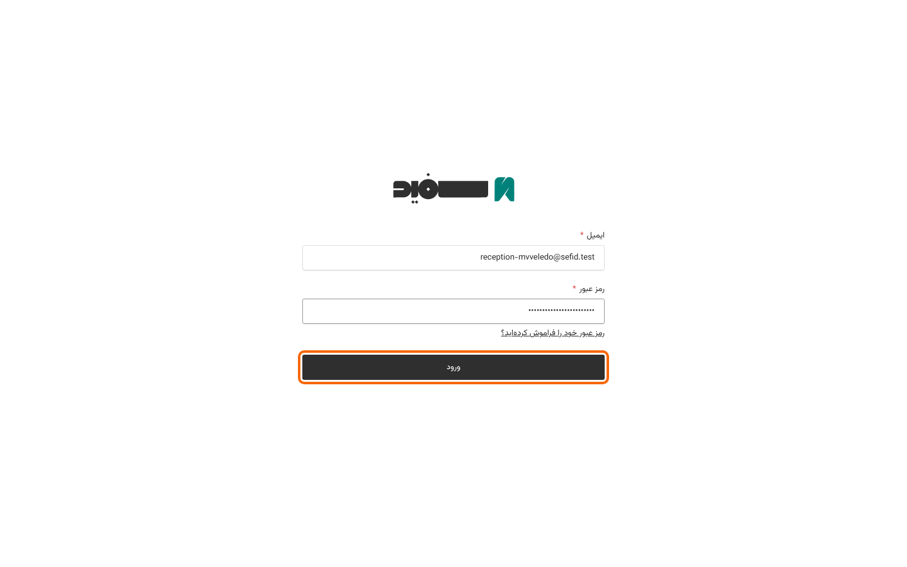

۵. صفحهٔ «راه‌اندازی احراز هویت دو مرحله‌ای» باز می‌شود. در این صفحه یک کد QR هست.

۶. برنامهٔ Authenticator را در گوشی کلینیک باز کنید.

۷. در برنامه، افزودن حساب تازه را بزنید.

۸. دوربین گوشی را روی کد QR صفحه بگیرید.

۹. برنامه یک عدد شش‌رقمی نشان می‌دهد. آن را از خانهٔ سمت راست بنویسید.

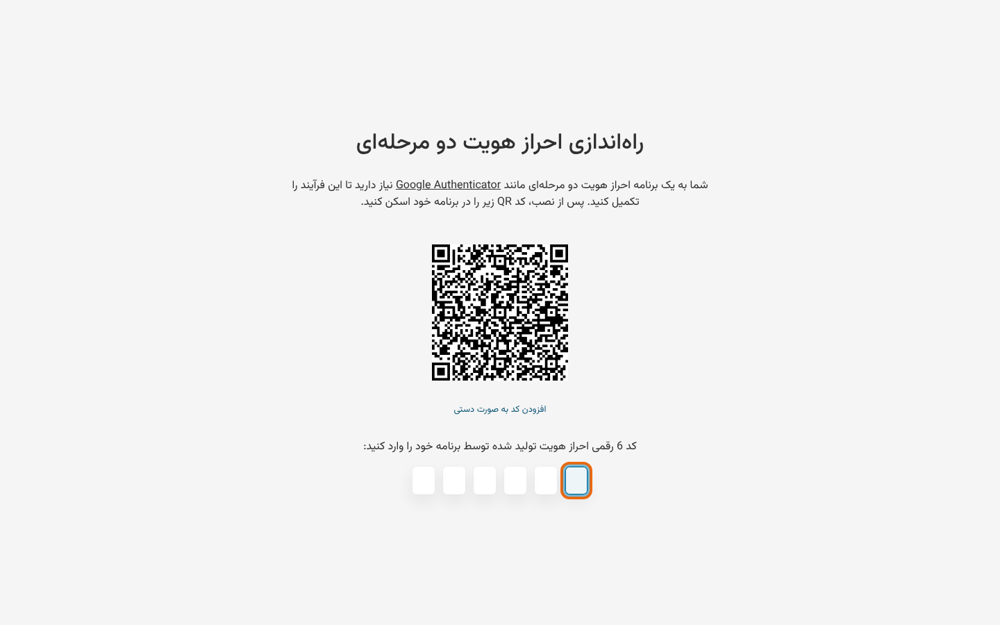

۱۰. صفحه خودش جلو می‌رود. داشبورد پنل باز می‌شود.

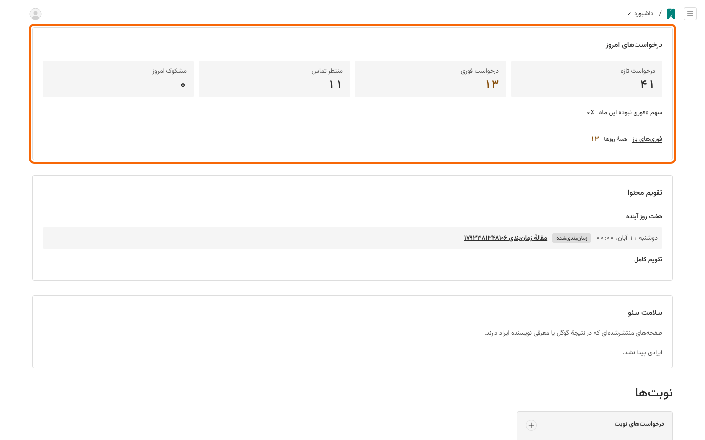

### دفعه‌های بعد

۱. نشانی پنل را باز کنید.

۲. ایمیل را بنویسید.

۳. رمز عبور را بنویسید.

۴. «ورود» را بزنید. صفحهٔ «تایید» باز می‌شود.

۵. برنامهٔ Authenticator را در گوشی کلینیک باز کنید.

۶. عدد شش‌رقمی تازه را از خانهٔ سمت راست بنویسید.

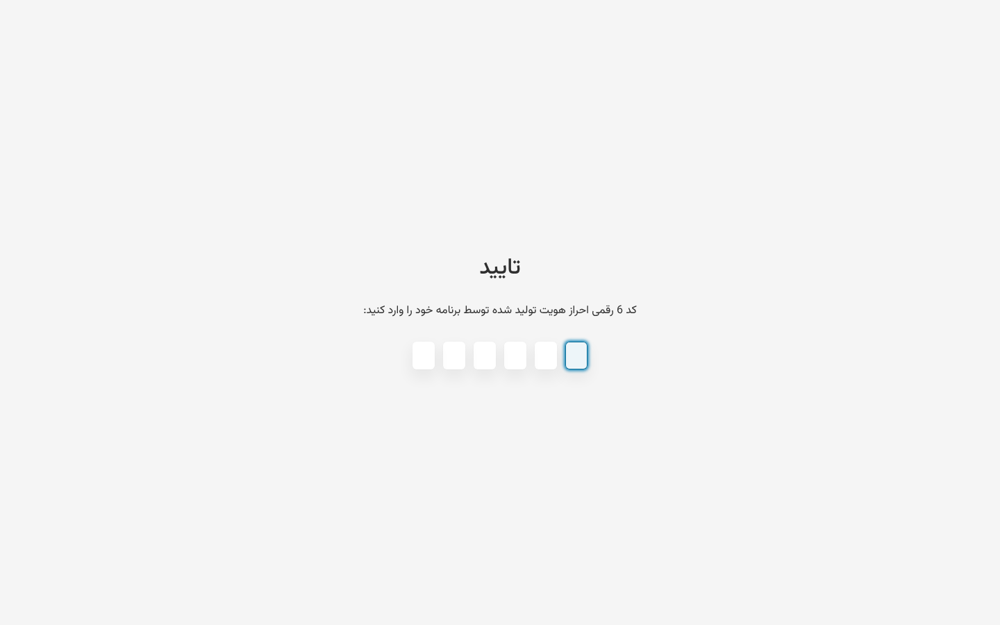

اگر عدد پذیرفته نشد، منتظر عدد تازهٔ برنامه بمانید. عدد تازه را بنویسید.

بعد از پنج رمز اشتباه، حساب پانزده دقیقه قفل می‌شود.

ورود هشت ساعت می‌ماند. بعد از آن، دوباره وارد شوید.

پیوند «رمز عبور خود را فراموش کرده‌اید؟» فعلاً ایمیلی نمی‌فرستد. اگر رمز را فراموش کردید، بخش ۱۰ را ببینید.

## ۲. درخواست‌های امروز

تا وقتی پیام خودکار درخواست‌ها راه نیفتاده است، هر درخواست فقط در پنل دیده می‌شود. در ساعات کاری، هر ساعت داشبورد را ببینید.

۱. در داشبورد، کادر «درخواست‌های امروز» را ببینید.

۲. «منتظر تماس» را بزنید. فهرست درخواست‌هایی باز می‌شود که هنوز با آن‌ها تماس نگرفته‌اید.

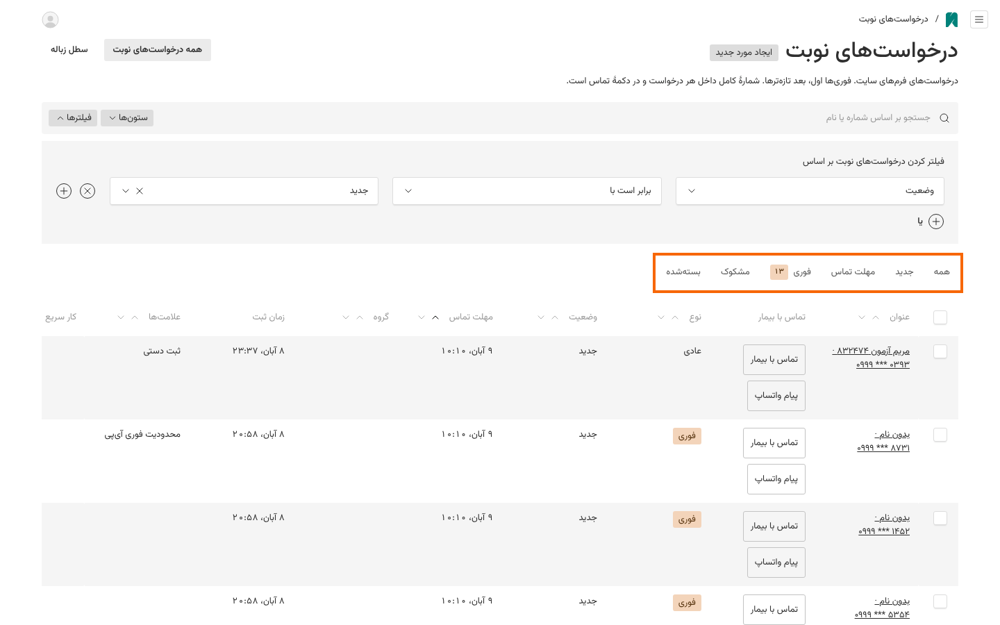

زبانه‌های بالای فهرست:

- «همه»: همهٔ درخواست‌ها، فوری‌ترین بالا.
- «جدید»: درخواست‌هایی که هنوز کسی با آن‌ها تماس نگرفته است.
- «مهلت تماس»: همان درخواست‌های جدید. هر کدام که مهلتش زودتر است بالاتر است.
- «فوری»: درخواست‌های فوری باز. عدد کنار آن تعداد این درخواست‌هاست. بخش ۶ را ببینید.
- «مشکوک»: درخواست‌هایی که سایت به آن‌ها شک دارد. بخش ۵ را ببینید.
- «بسته‌شده»: درخواست‌های انجام‌شده، لغوشده و هرزنامه.

## ۳. تماس با بیمار

۱. زبانهٔ «مهلت تماس» را بزنید.

۲. نام بیمار را در کادر جست‌وجو بنویسید.

۳. در ردیف بیمار، «تماس با بیمار» را بزنید. اگر رایانه تماس نمی‌گیرد، شماره را با تلفن کلینیک بگیرید.

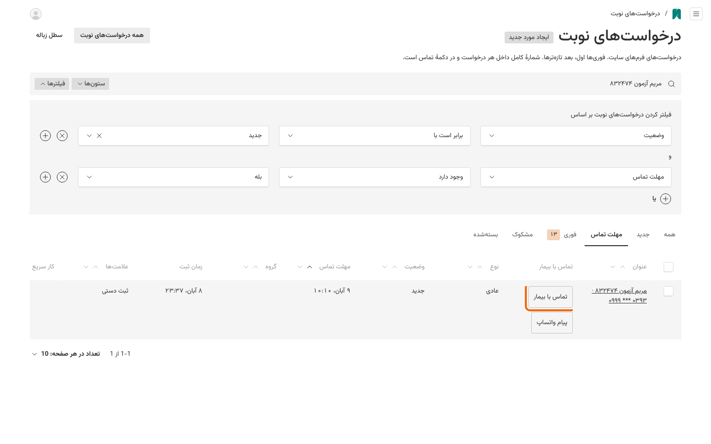

۴. اگر بیمار جواب نداد، «پیام واتساپ» را بزنید.

۵. بعد از تماس، نام بیمار را در ستون «عنوان» بزنید. پروندهٔ درخواست باز می‌شود.

۶. در «وضعیت»، «تماس گرفته شد» را انتخاب کنید. اگر نوبت دادید، «نوبت داده شد» را انتخاب کنید.

۷. در «یادداشت‌های پذیرش»، «افزودن یادداشت» را بزنید.

۸. بنویسید چه شد. مثال: «تماس گرفتم. فردا ساعت ۱۱ می‌آید.»

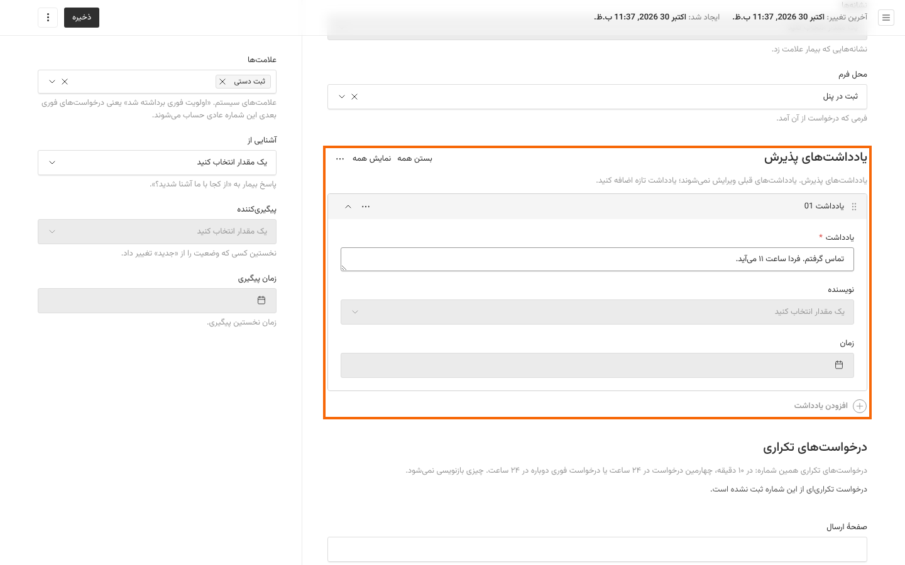

۹. «ذخیره» را بزنید.

اگر با بیمار حرف نزدید، وضعیت را عوض نکنید. فقط یک یادداشت بنویسید و ذخیره کنید. بعداً دوباره تماس بگیرید.

## ۴. بستن درخواست با یادداشت

وقتی کار بیمار تمام شد یا نوبتش لغو شد، درخواست را ببندید.

۱. پروندهٔ درخواست را باز کنید.

۲. در «وضعیت»، «انجام شد» یا «لغو شد» را انتخاب کنید.

۳. در «یادداشت‌های پذیرش»، «افزودن یادداشت» را بزنید.

۴. بنویسید چه شد.

۵. «ذخیره» را بزنید.

اگر یادداشت تازه ننویسید، پنل چیزی ذخیره نمی‌کند. این پیام قرمز بالای «وضعیت» می‌آید:

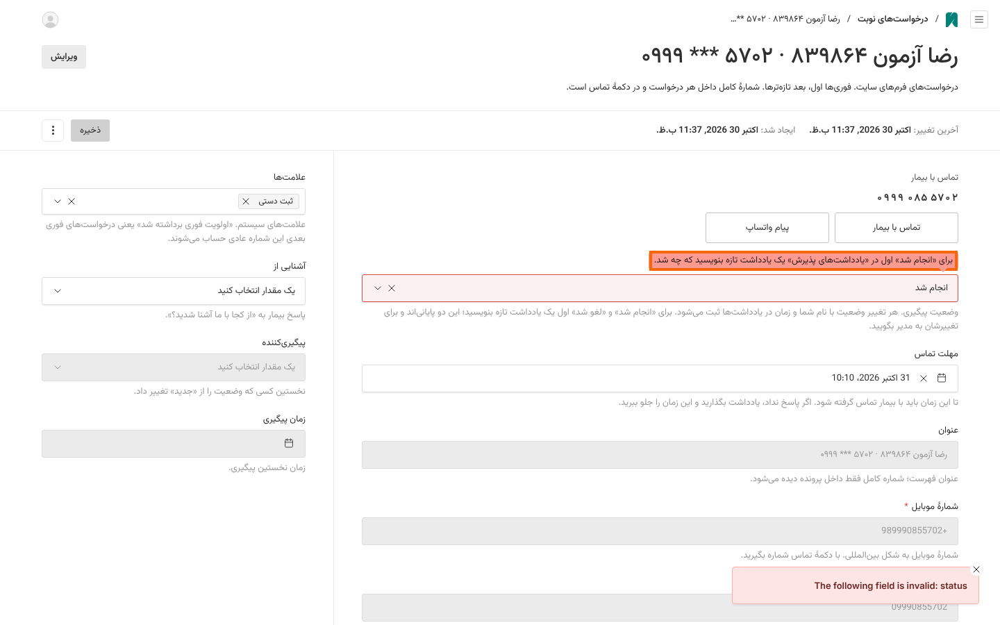

«انجام شد» فقط بعد از «تماس گرفته شد» یا «نوبت داده شد» انتخاب‌شدنی است.

درخواست بسته‌شده دوباره باز نمی‌شود. پیش از ذخیره، وضعیت را دوباره بخوانید.

## ۵. هرزنامه و درخواست مشکوک

پیام تبلیغاتی یا درخواست ساختگی را هرزنامه کنید.

۱. زبانهٔ «جدید» را بزنید.

۲. خانهٔ کنار هر درخواست هرزنامه را تیک بزنید.

۳. «علامت هرزنامه» را بزنید.

۴. پنجره‌ای باز می‌شود و تعداد را می‌گوید. تعداد را با تیک‌ها مقایسه کنید.

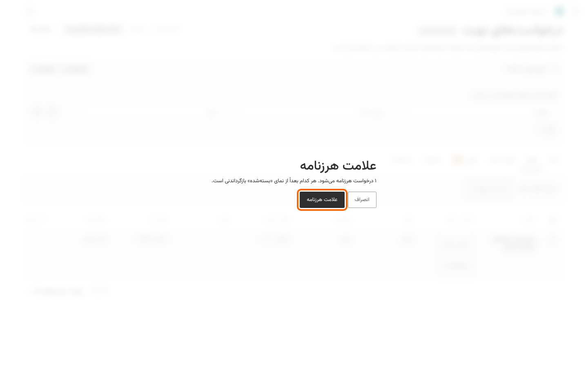

۵. «علامت هرزنامه» داخل پنجره را بزنید.

اگر اشتباه کردید: زبانهٔ «بسته‌شده» را بزنید. در ردیف آن درخواست، «بازگرداندن» را بزنید. درخواست به «جدید» برمی‌گردد.

سایت بعضی درخواست‌ها را مشکوک می‌داند، مثلاً وقتی فرم خیلی سریع پر شده است. هر روز زبانهٔ «مشکوک» را ببینید. اگر درخواست واقعی است، «بازگرداندن» را بزنید.

## ۶. درخواست فوری

درخواست فوری یعنی بیمار درد شدید، ورم، دندان شکسته یا خونریزی دارد. همیشه اول به درخواست فوری برسید.

۱. زبانهٔ «فوری» را بزنید.

۲. نام بیمار را در ستون «عنوان» بزنید.

۳. همان لحظه با بیمار تماس بگیرید.

۴. اگر ورم صورت بیمار به چشم یا گردن رسیده است، یا نفس کشیدن و قورت دادن برایش سخت است، بگویید همین حالا با اورژانس ۱۱۵ تماس بگیرد.

۵. در «نتیجهٔ تماس فوری»، «واقعاً فوری بود» یا «فوری نبود» را انتخاب کنید.

۶. در «وضعیت»، «تماس گرفته شد» یا «نوبت داده شد» را انتخاب کنید.

۷. در «یادداشت‌های پذیرش»، «افزودن یادداشت» را بزنید.

۸. بنویسید چه شد. مثال: «ورم صورت دارد. امروز ساعت ۱۷ می‌آید.»

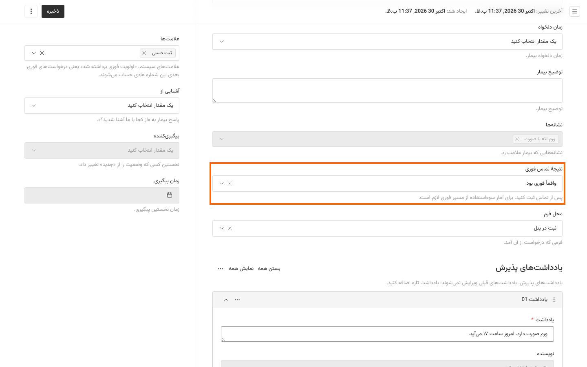

۹. «ذخیره» را بزنید.

## ۷. ساعات کاری و تعطیلات (با حساب مدیر)

سایت از روی این ساعت‌ها به بیمار می‌گوید کلینیک باز است یا بسته. تا تعطیلی وارد نشود، سایت آن روز را باز نشان می‌دهد.

۱. با حساب مدیر وارد شوید.

۲. در داشبورد، در بخش «تنظیمات»، «اطلاعات کلینیک» را بزنید.

۳. زبانهٔ «ساعات و تعطیلات» را بزنید.

۴. در «تعطیلات و روزهای خاص»، «افزودن روز» را بزنید.

۵. در «تاریخ (شمسی)»، تاریخ را بنویسید. مثال: ۱۴۰۶/۰۱/۰۲.

۶. در «عنوان»، نام روز را بنویسید. مثال: «تعطیل نوروز».

۷. اگر کلینیک آن روز بسته است، «شروع» و «پایان» را خالی بگذارید. اگر باز است، ساعت را بنویسید.

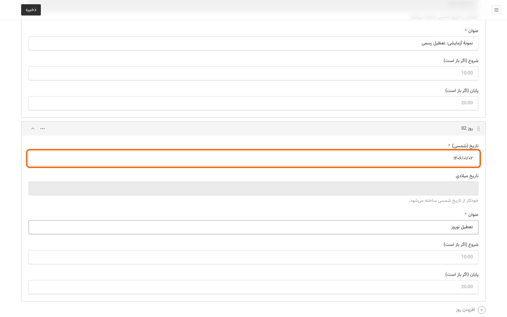

۸. «ذخیره» را بزنید.

تعطیلات رسمی هر سال را از تقویم رسمی وارد کنید. تعطیلات قمری هر سال جابه‌جا می‌شوند.

ساعت را به شکل ۲۴ساعته بنویسید، مثل `10:00` یا `20:30`.

اگر در شصت روز آینده هیچ تعطیلی وارد نشده باشد، «وضعیت سیستم» هشدار می‌دهد.

## ۸. وضعیت سیستم (با حساب مدیر)

هفته‌ای یک بار این صفحه را ببینید.

۱. با حساب مدیر وارد شوید.

۲. دکمهٔ منو را در گوشهٔ بالای صفحه بزنید.

۳. در منو، «وضعیت سیستم» را بزنید.

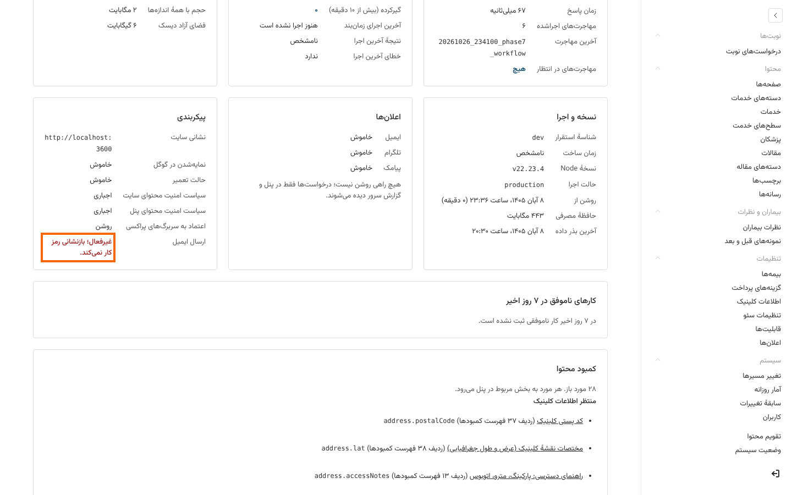

۴. نوشته‌های قرمز را بخوانید.

۵. اگر نوشتهٔ قرمز دیگری هست، از صفحه عکس بگیرید و برای استودیو بفرستید.

ردیف «ارسال ایمیل» تا راه‌اندازی ایمیل کلینیک قرمز است. این طبیعی است.

## ۹. کارهایی که هرگز نکنید

- در پنجرهٔ «زمان‌بندی انتشار»، پنل خودش «لغو انتشار» را انتخاب می‌کند. اگر زمان‌بندی می‌کنید، اول «انتشار» را انتخاب کنید. با «لغو انتشار»، صفحه منتشر نمی‌شود و اگر منتشر شده است، از سایت برداشته می‌شود.

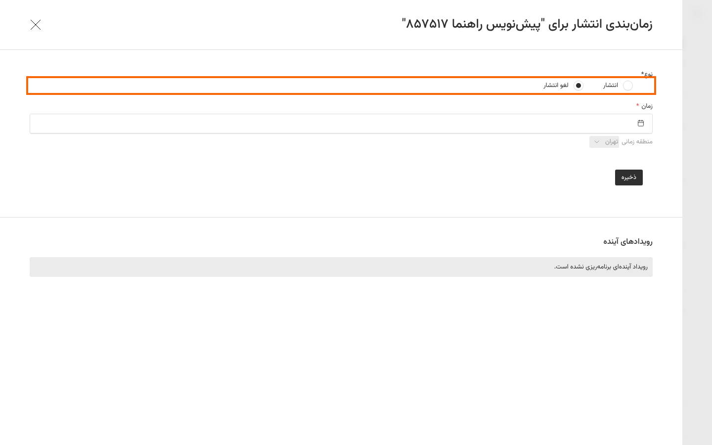

- رمز عبور یا عدد شش‌رقمی را به هیچ‌کس نگویید، حتی به استودیو.
- حساب خود را به همکار ندهید. هر نفر حساب خودش را دارد.
- درخواست بیمار واقعی را هرزنامه نکنید.
- درخواست را پاک نکنید. آن را با یادداشت ببندید.
- مقاله یا راهنما منتشر نکنید. این متن‌ها تا تعیین دندانپزشک ناظر پیش‌نویس می‌مانند.

## ۱۰. با چه کسی تماس بگیرید

- رمز عبور را فراموش کردید، گوشی کلینیک گم شد یا حساب قفل ماند: به استودیو خبر دهید. استودیو حساب را باز می‌کند و رمز موقت را تلفنی می‌گوید.
- پنل یا سایت باز نمی‌شود: به استودیو خبر دهید.
- «وضعیت سیستم» نوشتهٔ قرمز تازه دارد: به استودیو خبر دهید.
- بیمار در خطر است: بگویید با اورژانس ۱۱۵ تماس بگیرد.

در پیام به استودیو فقط شرح مشکل و عکس صفحه را بفرستید.

شمارهٔ استودیو: ............................
